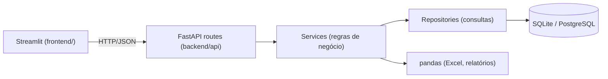

# ERP Básico (Python)

ERP simples e funcional com **dashboard de análises**, **relatórios exportáveis** e **leitura/importação de planilhas Excel**, organizado em camadas para crescer depois.

| Camada | Tecnologia |
|---|---|
| API (backend) | FastAPI + SQLAlchemy 2 + Pydantic 2 |
| Banco | SQLite (padrão) → PostgreSQL trocando `DATABASE_URL` |
| Dados / Excel | pandas + openpyxl |
| Interface | Streamlit + Plotly |
| Testes | pytest |

## Como rodar

```powershell
.\run.ps1 -Seed     # 1ª vez: cria dados de exemplo e sobe API + interface
.\run.ps1           # nas próximas vezes
```

Ou manualmente, em dois terminais:

```powershell
.\.venv\Scripts\python -m uvicorn backend.main:app --reload
.\.venv\Scripts\python -m streamlit run frontend/app.py
```

Outros comandos:

```powershell
.\.venv\Scripts\python -m scripts.seed --reset   # recria o banco com dados de exemplo
.\.venv\Scripts\python -m pytest                 # testes
```

A seed também gera `data/exemplos/planilha_exemplo.xlsx` (duas abas) para testar a tela de Excel.

## Funcionalidades

- **Dashboard** – faturamento, nº de vendas, ticket médio, lucro e margem, itens vendidos, clientes ativos, valor do estoque; gráfico por dia/semana/mês com média móvel; vendas por categoria; top produtos e clientes; alerta de estoque baixo.
- **Relatórios** – vendas por período, itens vendidos, curva de produtos (ABC), compras por cliente, posição de estoque. Exportação em **Excel** (formatado) e **CSV** (padrão BR) e análise rápida (agrupar + gráfico).
- **Planilhas Excel** – upload de `.xlsx/.xlsm/.csv`, escolha da aba, filtro, perfil das colunas, estatísticas e montagem de gráficos; **importação** de produtos/clientes com reconhecimento de sinônimos de colunas (ex.: *Código* → `sku`), números no formato `1.234,56`, upsert e relatório de erros por linha; download de planilha modelo.
- **Operação** – vendas com carrinho (baixa de estoque transacional, cancelamento com estorno), cadastros de produtos e clientes com exclusão lógica.

## Arquitetura



```
erp_system/
├── backend/
│   ├── main.py              # cria o app FastAPI, CORS, tratamento de erros
│   ├── core/                # config (.env), banco, exceções, exportadores, utils
│   ├── models/              # tabelas ORM: Cliente, Produto, Venda, ItemVenda
│   ├── schemas/             # contratos de entrada/saída (Pydantic)
│   ├── repositories/        # acesso a dados
│   ├── services/            # regras: vendas, dashboard, relatórios, Excel
│   └── api/                 # rotas REST (/api/v1/...) + injeção de dependências
├── frontend/
│   ├── app.py               # navegação
│   ├── api_client.py        # único ponto de contato com a API
│   ├── components.py        # filtros de período, formatação R$, tratamento de erros
│   └── views/               # dashboard, relatórios, excel, vendas, produtos, clientes
├── scripts/seed.py          # dados de exemplo
└── tests/                   # testes de ponta a ponta da API
```

**Por que assim?** A interface não acessa o banco: tudo passa pela API. Assim dá para trocar o Streamlit por React/Vue, criar um app mobile ou integrar outros sistemas sem tocar nas regras de negócio.
